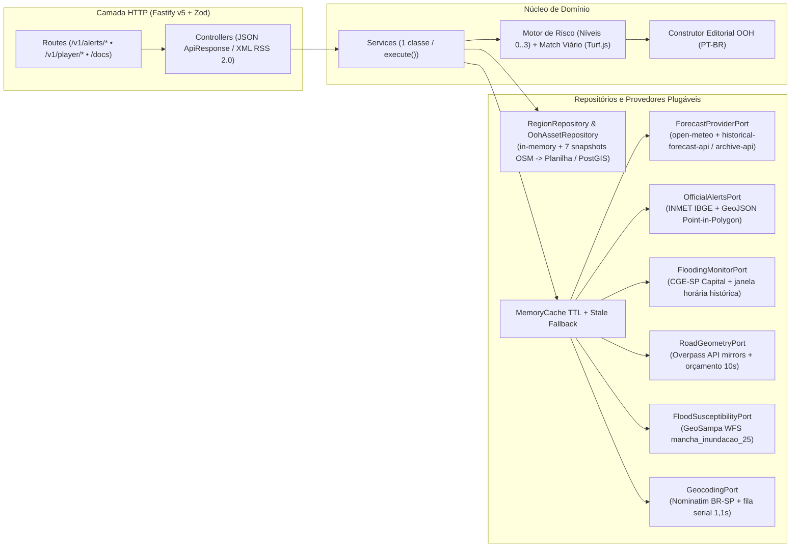

# Arquitetura da Plataforma — OOH Alerta Alagamentos

Este documento registra a visão arquitetural do backend, o modelo de provedores plugáveis, o pipeline de replay histórico e a arquitetura geoespacial para o Player Criativo DOOH.

---

## 1. Visão em Camadas (Padrão `kibon` + Provedores Plugáveis)

---

## 2. Estratégia de Fontes Meteorológicas, Hidrológicas e Geoespaciais

### 2.1 Camada de Previsão Hiperlocal e Replay Histórico (`ForecastProviderPort`)
- **Tempo Real (`open-meteo`):** `Open-Meteo` consultado por `latitude/longitude`, entregando probabilidade horária de precipitação (`precipitation_probability`) e volume previsto (`mm/h`) com resolução de grade (~9 km).
- **Replay Histórico (`open-meteo-historical`):** consultas com `date` (`YYYY-MM-DD`) utilizam `https://historical-forecast-api.open-meteo.com/v1/forecast` (com probabilidade horária real, sem limite de 5 dias) e fallback para `archive-api.open-meteo.com/v1/archive` (convertendo chuva observada `>= 0.3 mm` em `100%` quando `precipitation_probability` está ausente). O cache e o estado de saúde de `open-meteo-historical` são isolados do provedor em tempo real.
- **Evolução para Produção (Provedor Pago):** provedores comerciais (**Tomorrow.io**, **Google Weather API**) implementam apenas `ForecastProvider` e são selecionados via `FORECAST_PROVIDER` no `.env`. Open-Meteo gratuito é restrito à fase PoC.

### 2.2 Camada de Avisos Oficiais (`OfficialAlertsPort`)
- **INMET (`/avisos/ativos`):** fonte federal cobrindo todo o território nacional com graus de severidade (`Perigo Potencial`, `Perigo`, `Grande Perigo`), códigos IBGE (`geocodes`) e polígonos GeoJSON.
- Em consultas históricas (`date` / `cgeDate`), `officialAlerts` é marcado como `status: "skipped"`.

### 2.3 Camada Hiperlocal de Alagamentos (`FloodingMonitorPort`)
- **Capital SP (`IBGE 3550308`):** `CGE-SP` fornece pontos de alagamento por zona, bairro e via e estações meteorológicas por subprefeitura.
- **Reconstrução por Janela Horária (`cge-sp-time-window.ts`):** no modo histórico, interpreta janelas `De HH:MM a HH:MM` e `Desde HH:MM` para recalcular `active` e `status` no minuto solicitado (`time`) ou no minuto de pico automático do dia (desempate por intransitáveis e horário mais cedo). Caso não haja ocorrências CGE válidas no dia, utiliza a hora de pico de precipitação do Open-Meteo (ou `12:00` se seco). Estações CGE não possuem série histórica, ficando `stationRainfall: null`.
- **Execução condicional:** fora da Capital SP, `floodingMonitor` assume `status: "skipped"`.

### 2.4 Camada Geoespacial para o Player DOOH (`RoadGeometry`, `GeoSampa WFS`, `Nominatim`)
- **Catálogo Curado (`OohAssetRepository`):** os 7 corredores OOH icônicos da PoC possuem geometrias reais extraídas do OpenStreetMap (`curated-ooh-geometries.ts`, validadas com Zod e com atribuição ODbL), garantindo carregamento instantâneo e determinístico (`provider: "osm-curated-snapshot"`).
- **Clique Livre (`OverpassRoadGeometryProvider`):** consulta mirrors configuráveis em `OVERPASS_URLS` via `POST`, com orçamento total de `10 s` (`4,5 s` por mirror) e expansão progressiva de raio (`300 m` → `450 m`). Sujeito às restrições da instância pública na fase PoC; cache TTL de `86400 s`.
- **Suscetibilidade Municipal (`GeoSampaWfsProvider`):** consulta WFS 2.0.0 da PMSP (`geoportal:mancha_inundacao_25`, fallback `geoportal:area_inundavel`) com `bbox=${minLat},${minLon},${maxLat},${maxLon},urn:ogc:def:crs:EPSG::4326` (ordem de eixos EPSG::4326 obrigatória no WFS 2.0.0) e timeout de `5 s`. Em `match-road-risk.ts`, aplica buffer de `20 m` (`@turf/buffer`) antes de `@turf/boolean-intersects` para capturar interseções com polígonos pequenos (~86 m²). Executado apenas na Capital SP (`status: "skipped"` fora de SP).
- **Geocodificação (`NominatimGeocodingProvider`):** busca textual restrita a `BR-SP` (*viewbox* RMSP) com `User-Agent` dedicado, fila serial interna de `>= 1100 ms` entre chamadas e cache TTL de `86400 s`.

---

## 3. Evolução para Pontos OOH Reais (Planilha / PostGIS)

Quando a relação oficial de pontos OOH for integrada na Fase 2:
1. `OohAssetRepository` e `RegionRepository` recebem implementações `Prisma/PostGIS` preservando exatamente os contratos usados pelos serviços de alertas e `/v1/player/*`.
2. **Spatial Clustering:** pontos OOH próximos (célula de 2–3 km) compartilham o cache meteorológico enquanto preservam matching individual por corredor e histórico de risco.

---

## 4. Resiliência, Proteção DOOH e Tolerância a Falhas

- **Isolamento de falhas externas:** fontes são consultadas em paralelo (`Promise.allSettled`) com timeouts explícitos, *stale fallback* no `MemoryCache` e degradação graciosa em `/v1/player/scene` (falha total do Overpass ou GeoSampa retorna HTTP `200` com `roads.features: []` / `geoSampaZonesCount: 0` e status `"error"` na respectiva fonte).
- **Proteção de Feeds RSS (`/feed.xml`):** endpoints XML/RSS rejeitam `date` e `time` com HTTP `400` para impedir que um player em campo exiba replay histórico como alerta ao vivo.
