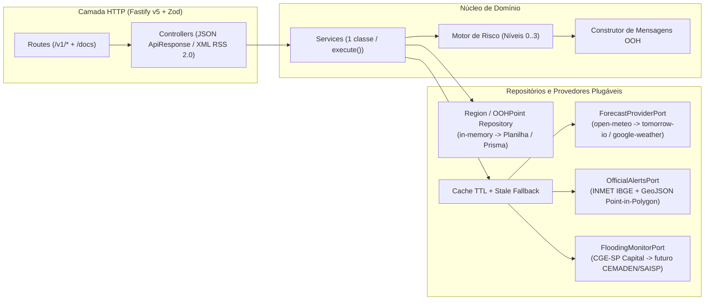

# Arquitetura da Plataforma — OOH Alerta Alagamentos

Este documento registra a visão arquitetural do backend, o modelo de provedores plugáveis e a estratégia de evolução da PoC (Capital SP) até a produção multi-município com pontos OOH reais.

---

## 1. Visão em Camadas (Padrão `kibon` + Provedores Plugáveis)

---

## 2. Estratégia de Fontes Meteorológicas e Hidrológicas

### 2.1 Camada de Previsão Hiperlocal (`ForecastProviderPort`)
- **Na PoC:** `Open-Meteo` consultado por `latitude/longitude`, entregando probabilidade horária de precipitação (`precipitation_probability`) e volume previsto (`mm/h`) com resolução de grade (~9 km via ECMWF/modelos globais), já diferenciando zonas distintas da Capital SP.
- **Evolução para Produção (Provedor Pago):** qualquer provedor comercial (**Tomorrow.io** ~2,5–3 km / *nowcasting* 5–15 min, **Google Weather API** ou **Open-Meteo Comercial**) implementa apenas `ForecastProviderPort` e é selecionado via `FORECAST_PROVIDER` no `.env`, sem alterações em `services`, `controllers` ou `routes`.

### 2.2 Camada de Avisos Oficiais (`OfficialAlertsPort`)
- **INMET (`/avisos/ativos`):** fonte federal cobrindo todo o território nacional com graus de severidade (`Perigo Potencial`, `Perigo`, `Grande Perigo`), códigos IBGE (`geocodes`) e polígonos GeoJSON.
- O *adapter* verifica tanto o código IBGE do município (ex.: `3550308` para São Paulo) quanto a interseção *point-in-polygon* para consultas por coordenadas.

### 2.3 Camada Hiperlocal de Alagamentos (`FloodingMonitorPort`)
- **Capital SP (`IBGE 3550308`):** `CGE-SP` fornece pontos de alagamento ativos (transitáveis/intransitáveis por zona, bairro e via) e estações meteorológicas por subprefeitura/bairro.
- **Execução condicional:** o conector do CGE-SP é acionado apenas para pontos dentro da Capital SP, mantendo o fluxo íntegro para qualquer outro município do Estado de São Paulo.
- **Expansão estadual:** a mesma porta acomoda futura integração com **CEMADEN** (após emissão de token JWT institucional da PED) e **SAISP**.

---

## 3. Evolução para Pontos OOH Reais (Planilha 5 Anos)

Quando a relação oficial de pontos OOH (relógios urbanos e painéis em áreas com histórico de alagamentos nos últimos 5 anos) for recebida:
1. Cada ponto será carregado via `Repository` mantendo `id`, `lat/lon`, `ibgeCode`, `zone`, `cgeStationId` (opcional) e `historicalRiskWeight`.
2. **Spatial Clustering:** pontos OOH próximos (ex.: dentro de uma célula de 2–3 km) compartilham o cache da mesma consulta de previsão meteorológica, reduzindo em até ~80–90% o volume de chamadas a APIs pagas enquanto cada relógio mantém sua própria regra de exibição e histórico de risco.

---

## 4. Resiliência e Tolerância a Falhas

- **Isolamento de falhas externas:** o serviço agregador executa consultas às fontes em paralelo com `Promise.allSettled` e timeouts rígidos.
- **Degradação graciosa:** em caso de instabilidade de um órgão público, o cache retorna o último snapshot válido (*stale fallback*) sinalizando o estado degradado nos metadados de diagnóstico, evitando que os players DOOH fiquem sem resposta.
