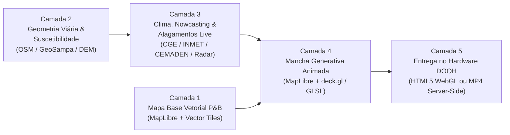

# 02 — Pesquisa de Stack e Fontes de Dados (Player Criativo DOOH)

Este documento consolida a pesquisa técnica das dependências, bibliotecas, serviços geoespaciais e fontes de dados — **gratuitos e pagos**, incluindo recursos **citados no PDF** e **alternativas extras de mercado** — necessárias para reproduzir os mockups da tela DOOH (Slides 7, 9, 10, 11 e 12): **mapa vetorial minimalista preto/branco + mancha de enchente azul luminosa animada sobre a geometria real da via**.

---

## Visão em 5 Camadas do Pipeline DOOH

---

## Camada 1 — Mapa Base Vetorial Customizável (Estética P&B Minimalista)

Os mockups exigem controle total sobre cores, espessura de vias, remoção de POIs e tipografia dos rótulos — o que só é possível com **Vector Tiles + Style JSON customizado**.

| Recurso | No PDF? | Modelo / Custo | Avaliação Técnica |
| :--- | :---: | :--- | :--- |
| **MapLibre GL JS** | Sim | **100% Gratuito** (Open-source BSD) | Engine WebGL client-side sem API key e sem limite de uso. Exige apenas uma fonte de *vector tiles*. |
| **OpenFreeMap** | Extra | **Gratuito** (sem API key, sem limite de views) | Ideal para **PoC e MVP**: entrega *vector tiles* do OpenStreetMap prontos para MapLibre com estilo totalmente editável. **Ressalva:** projeto comunitário sem SLA contratual para produção crítica. |
| **Protomaps (`.pmtiles`) + Cloudflare R2 / S3** | Extra | **Custo mínimo** (software open-source; ~USD 5–10/mês em storage/CDN) | **Melhor opção para produção em escala OOH.** Empacota o recorte vetorial de SP ou do Brasil em um único arquivo `.pmtiles` servido via *HTTP Byte-Range Requests*. Zera custos por *map load* e elimina risco de bloqueio/quota de SaaS. |
| **Mapbox GL / Styles** | Sim (alt.) | **Freemium / Pago** (50k *map loads*/mês grátis; ~USD 5 por 1k loads extras) | Possui o *Mapbox Studio* (ótimo para ajuste fino visual com direção de arte). Exige controle de cache/sessão para evitar cobranças inesperadas em larga escala de telas. |
| **MapTiler Cloud** | Extra | **Pago p/ uso comercial** (tier gratuito é estritamente não-comercial; pagos a partir de ~USD 30/mês) | Cobrança por sessão; inviável usar plano grátis em campanhas comerciais. |

---

## Camada 2 — Geometria Real das Vias & Suscetibilidade Topográfica/Histórica

Atende ao **Passo 1 do Slide 12** (*"Geometric Real: OSM (rua) + zona de cota baixa"*), garantindo que a mancha siga exatamente o traçado viário sem arte manual.

| Recurso | No PDF? | Modelo / Custo | Avaliação Técnica |
| :--- | :---: | :--- | :--- |
| **OpenStreetMap — Overpass API** | Sim (OSM) | **Gratuito** | Consulta HTTP sob demanda de geometrias reais (`LineString`) em qualquer raio/`bbox`. Ideal para **seleção livre na PoC**, desde que protegida por cache TTL + *stale fallback* no backend. |
| **Geofabrik (`.osm.pbf`) + PostgreSQL/PostGIS** | Sim (OSM + PostGIS) | **Gratuito** (custo de infra DB) | Padrão ouro de **produção**: importa o recorte regional de SP/Brasil (`osm2pgsql`) com índices espaciais (`ST_DWithin`, `ST_Intersects`), latência de milissegundos e independência total de APIs externas. |
| **Overture Maps (Transportation Layer)** | Extra | **Gratuito** (Open Data — Linux Foundation / Meta / Microsoft / Amazon / TomTom) | Malha viária global já limpa, segmentada e padronizada em **GeoParquet** (consultável via DuckDB/Python e exportável para PostGIS/GeoJSON). Reduz muito o tratamento topológico necessário no OSM bruto. |
| **GeoSampa WFS / Downloads (PMSP)** | Sim | **Gratuito** (Oficial Prefeitura SP) | Endpoint WFS aberto (`http://wfs.geosampa.prefeitura.sp.gov.br/geoserver/geoportal/wfs`) com camadas oficiais em GeoJSON/Shapefile: **Mancha de Inundação** (períodos de retorno 5, 25 e 100 anos), **Alagamento (Ocorrências)**, **Inundação (Ocorrências)**, **Hidrografia/Córregos subterrâneos** e **MDE** (download no portal). **Limitação:** restrito à Capital SP. |
| **Copernicus DEM (30m) / SRTM / Topodata (INPE)** | Extra | **Gratuito** | Alternativa nacional de altimetria/topografia para identificar fundos de vale e cotas baixas fora da Capital SP. |
| **Turf.js + `osmtogeojson`** | Extra | **Gratuito** (NPM) | Operações geométricas em TypeScript/Node.js ou browser (`booleanIntersects`, `lineSliceAlong`, `buffer`, `nearestPointOnLine`) sem exigir PostGIS na fase de PoC. |
| **QGIS** | Sim | **Gratuito** (Desktop) | Preparação offline (ETL geográfico) para inspecionar e cruzar camadas GeoSampa, MDE e OSM. |

---

## Camada 3 — Dados em Tempo Real: Clima, Nowcasting e Alagamentos

Atende ao **Passo 2 do Slide 12** (*"Dado marca o trecho — está alagando aqui, agora"*).

| Fonte / API | No PDF? | Modelo / Custo | O que entrega & Considerações |
| :--- | :---: | :--- | :--- |
| **CGE-SP** *(já integrado)* | Sim | **Gratuito** (HTML scraping) | Pontos de alagamento ativos/intransitáveis + 28 estações pluviométricas na Capital SP. Como os endereços vêm em texto livre, exige **normalização / map-matching** para vincular ao segmento exato no OSM. |
| **INMET** *(já integrado)* | Sim | **Gratuito** (API REST oficial) | Avisos meteorológicos oficiais com polígonos GeoJSON em todo o Brasil. Granularidade macro (município/região). |
| **Open-Meteo** *(já integrado)* | Sim (modelos ECMWF/NOAA) | **Gratuito (PoC / não-comercial)** / **Pago (planos comerciais fixos)** | Previsão horária (~9 km via ECMWF) e suporte a `minutely_15` em modelos de alta resolução. **Atenção:** uso comercial exige assinatura paga ou troca de provedor. |
| **CEMADEN** | Sim | **Gratuito** *(sem API REST pública documentada)* | Rede nacional com >3.800 pluviômetros e alertas hidrológicos. Exige credencial/acesso institucional ou integração com camadas OGC/ArcGIS (atenção ao fuso UTC e estabilidade). |
| **Tomorrow.io** *(previsto no backend)* | Extra | **Pago** (teste grátis limitado; comercial sob cotação) | Principal candidato para embasar *"risco em 30 min"*: previsão **minuto a minuto** baseada em radar + satélite + ML. |
| **Google Weather API** *(previsto no backend)* | Extra | **Pago pay-as-you-go** (cota grátis ~10k calls/mês; depois ~USD 0,15/1k) | Previsão hiperlocal por coordenada via Google Cloud. |
| **Google Flood Forecasting API (Flood Hub)** | Extra | **Gratuito** (requer aprovação em *allowlist* Google Cloud) | Cobre totalmente o **Brasil** (em parceria com SGB/CPRM), oferecendo previsões hidrológicas e **polígonos de inundação fluvial** — muito forte para extravasamento de grandes bacias (ex.: rios Pinheiros e Tietê). |
| **SAISP / SIBH (FCTH / DAEE-SP)** | Extra | **Institucional / Convênio** | Telemetria em tempo real de nível de água em rios e córregos de SP + Radar Meteorológico de Ponte Nova. |
| **Waze for Cities (Partner Feed)** | Extra | **Gratuito apenas via parceria municipal** (CET/Prefeitura) | Feed JSON real-time de alertas `HAZARD` (alagamento) reportados por motoristas já com `lat/lon` exata e score de confiabilidade. |
| **Geocodificação & Map-Matching** (`Nominatim` / `Photon` / Tabela curada) | Extra | **Gratuito** (Nominatim/OSM ou tabela de-para) / **Pago** (Mapbox/Google) | Converte buscas de endereço por texto e ocorrências textuais do CGE-SP em coordenadas/trechos viários reais. Para produção em SP, manter tabela curada dos ~300 pontos crônicos do CGE vinculados a `way_id` do OSM maximiza precisão e reduz custo. |

---

## Camada 4 — Renderização da Mancha Generativa Animada

Atende aos **Passos 3 e 4 do Slide 12** (*Buffer + Camadas + Brilho* em movimento contínuo sobre a rua).

| Tecnologia | No PDF? | Modelo / Custo | Prós e Contras |
| :--- | :---: | :--- | :--- |
| **MapLibre GL JS + `deck.gl` (`@deck.gl/mapbox` + `PathLayer` / Shader GLSL)** | Sim | **100% Gratuito** (Open-source) | 100% fiel à arquitetura do Slide 12. Permite camadas sobrepostas de alta performance em WebGL e *shaders* GLSL customizados para efeito fluido de correnteza/onda e brilho luminoso ao longo da avenida. |
| **MapLibre GL JS Puro (multi-camadas `line-blur` / `CustomLayerInterface`)** | Extra | **100% Gratuito** (Open-source) | Alternativa mais enxuta em bundle e consumo de GPU caso o hardware de algum totem apresente restrições com WebGL2 avançado. |
| **Canvas 2D / SVG Animado (Fallback)** | Extra | **100% Gratuito** | Contingência para players legados sem suporte a WebGL. |

---

## Camada 5 — Entrega e Compatibilidade no Hardware DOOH

| Cenário da Exibidora | Dependência / Estratégia | Custo |
| :--- | :--- | :--- |
| **1. Player com HTML5 + WebGL + rede aberta** | Execução direta do Player React + MapLibre + deck.gl, com cache resiliente / *stale fallback* para sobreviver a oscilações de rede. | Apenas hospedagem/CDN |
| **2. Player restrito a MP4 / WebM / Imagem via CMS** | **Renderizador Server-Side (`Playwright` + `FFmpeg`):** worker gera loops MP4 de 10–15 s apenas quando o estado de risco de um ativo muda e publica a URL no feed/CMS da exibidora. | Baixo (renderização orientada a evento, não contínua) |

---

## Comparativo de Stacks Recomendadas: PoC (Custo Zero) vs. Produção Comercial

| Camada | Opção 1 — PoC / Validação Visual (**Custo Zero**) | Opção 2 — Produção Comercial (Escala & SLA) |
| :--- | :--- | :--- |
| **Mapa Base** | `MapLibre GL JS` + `OpenFreeMap` (estilo P&B customizado) | `MapLibre GL JS` + **Protomaps (`.pmtiles`)** em Cloudflare R2/S3 (ou Mapbox gerenciado) |
| **Geometria Viária** | GeoJSON real em cache local (presets SP) + `Overpass API` (seleção livre) + `Turf.js` | **PostgreSQL + PostGIS** + **Overture Maps / Geofabrik OSM** + tabela de *map-matching* CGE |
| **Suscetibilidade / Relevo** | `GeoSampa WFS` (`Mancha de Inundação` / ocorrências SP) com fallback gracioso | `GeoSampa` (SP) + **Copernicus DEM 30m** (escala nacional) indexados em PostGIS |
| **Busca de Endereço** | `Nominatim (OSM)` via proxy com cache TTL no backend | `Photon` self-hosted ou Mapbox/Google Geocoding |
| **Clima & Alagamentos** | `CGE-SP` + `INMET` + `Open-Meteo` (já integrados) + simulação/replay | **Tomorrow.io** (nowcasting) + `CGE-SP` + `CEMADEN` (institucional) + `INMET` + **Google Flood Forecasting API** |
| **Mancha Generativa** | `deck.gl` (`@deck.gl/mapbox` `PathLayer` + camadas/shader animado) | `deck.gl` (HTML5) + worker opcional `Playwright + FFmpeg` (MP4 para CMS restritos) |
