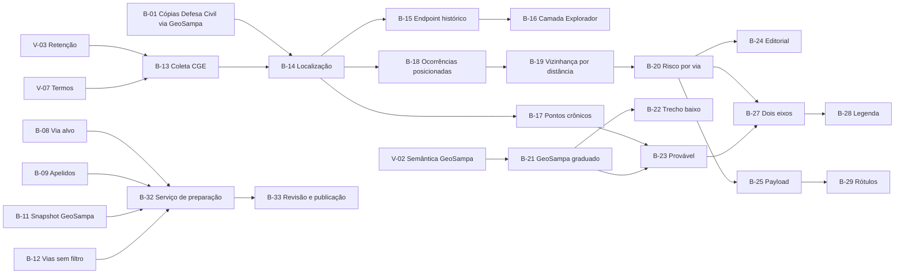

# 10 — Roadmap e Backlog Consolidado

> **Status:** Documento vivo — **ponto de entrada para planos de implementação**. Revisar sempre que uma decisão for tomada ou uma investigação concluída.
> **Última revisão:** 27/11/2026.
> **Consolida:** [04](./04-escopo-alertas-vias-vizinhas.md) · [05](./05-avaliacao-fontes-tempo-real.md) · [06](./06-criterios-horizonte-e-antialarmismo.md) · [07](./07-avaliacao-geosampa-suscetibilidade.md) · [08](./08-escopo-base-historica-alagamentos.md) · [09](./09-escopo-cadastro-pontos-ooh.md)

Este documento reúne em um só lugar o backlog deduplicado, a ordem sugerida, as dependências, as decisões pendentes e as investigações de validação. Os detalhes de cada item continuam nos documentos de origem; aqui ficam só a referência e o encadeamento.

---

## 1. Como Usar

1. Antes de planejar uma fase, conferir o **status** de cada item (seção 2) e as **decisões** (seção 5) e **investigações** (seção 6) de que ele depende.
2. Itens `pronto para planejar` podem virar plano de implementação imediatamente.
3. Itens que dependem do cliente **não têm prazo nem estimativa de compromisso**; o roadmap mostra só a ordem e as dependências.
4. Ao concluir um item, decisão ou investigação, atualizar este documento e o documento de origem.

### 1.1 Legenda de status

| Status | Significado |
| :--- | :--- |
| `pronto` | Pronto para planejar. Não depende de decisão nem de investigação pendente. |
| `decisão` | Depende de uma decisão pendente (`DEC-xx`). |
| `investigação` | Depende de uma investigação de validação (`V-xx`). |
| `aprovação` | Só começa após a aprovação do projeto pelo cliente. |
| `item` | Depende da conclusão de outro item do backlog (`B-xx`). |

### 1.2 Identificadores

- `B-xx`: item do backlog (este documento).
- `DEC-xx`: decisão pendente (este documento).
- `V-xx`: investigação de validação (este documento).
- `D`, `R` (docs/04), `A`, `C` (docs/06), `G` (docs/07): identificadores dos documentos de origem, citados para rastreabilidade.

**Esforço** é uma ordem de grandeza relativa (`baixo` / `médio` / `alto`), não uma estimativa de prazo.

---

## 2. Backlog por Fase

As fases 1 e 2 não dependem do cliente e podem andar em paralelo. A fase 6 só começa após a aprovação do projeto.

### Fase 0 — Ação urgente

| ID | Item | Origem | Camada | Esforço | Status | Depende de |
| :--- | :--- | :--- | :--- | :---: | :--- | :--- |
| B-01 | **Salvar cópias periódicas das camadas de ocorrência da Defesa Civil publicadas no GeoSampa** (WFS: `risco_ocorrencia_alagamento`, `risco_ocorrencia_inundacao`), deduplicando por `cd_identificador`. A camada parece guardar só o ano corrente: cada atualização perdida é dado que não volta. | docs/08 §3.2, §6 | backend (script) | baixo | `pronto` | — |

### Fase 1 — Correções antialarmismo de baixo custo

| ID | Item | Origem | Camada | Esforço | Status | Depende de |
| :--- | :--- | :--- | :--- | :---: | :--- | :--- |
| B-02 | Avisos INMET só contam dentro da janela `inicio`–`fim` | A1 / C2 | backend | baixo | `pronto` | — |
| B-03 | Avisos INMET só contam se relacionados a chuva/alagamento | A2 / C3 | backend | baixo | `pronto` | — |
| B-04 | Textos em escala de horas ("nas próximas horas") e linguagem proporcional por nível (ATENÇÃO fala em chuva, não em alagamento) | C1 / C6 | backend | baixo | `pronto` | — |
| B-05 | Corroboração: nenhum sinal isolado acima de ATENÇÃO | A3 / A6 / A8 / C4 | backend | médio | `pronto` | — |
| B-06 | Estabilidade: subir após ciclos consecutivos, descer com histerese | A7 / C7 | backend | médio | `pronto` | — |
| B-07 | Mancha só com evidência local: tratar a mancha presumida na via alvo e em áreas GeoSampa sem evidência | D8 / D10 / A5 / G8 / R5 / C6 | backend + frontend | médio | `decisão` | DEC-12 |

### Fase 2 — Paridade catálogo × clique livre (base do serviço de preparação de pontos)

| ID | Item | Origem | Camada | Esforço | Status | Depende de |
| :--- | :--- | :--- | :--- | :---: | :--- | :--- |
| B-08 | Via alvo pela **distância até a linha**, ignorando vias sem nome e agrupando as pistas do mesmo corredor | docs/09 §5 | backend | médio | `pronto` | — |
| B-09 | **Tabela global de apelidos** (números por extenso, abreviações, títulos) para o casamento com o CGE | docs/09 §4, §5 | backend | baixo–médio | `pronto` | — |
| B-10 | Aviso visível quando a geometria viária falha (em vez de peça sem mancha em silêncio) | docs/09 §5, D17 | backend + frontend | baixo | `pronto` | — |
| B-11 | Snapshot GeoSampa local para os pontos curados | G4 | backend | baixo | `pronto` | — |
| B-12 | Extração de vias sem filtro por nome, com raio de influência ampliado e ruas residenciais | D1 / D2 / D6 / R3 | backend | médio | `decisão` | DEC-10 |

### Fase 3 — Base histórica de alagamentos

| ID | Item | Origem | Camada | Esforço | Status | Depende de |
| :--- | :--- | :--- | :--- | :---: | :--- | :--- |
| B-13 | Coleta dos 5 anos do CGE + coleta diária (D-1) | docs/08 §4 | backend (script) | baixo | `investigação` | V-03, V-07 |
| B-14 | Localização das ocorrências CGE (por trecho, fallback por via marcado como aproximado, apoio SIGRC, tabela curada), com piloto nos bairros dos 7 pontos | docs/08 §4.1 | backend | **alto** | `item` / `decisão` | B-13, DEC-19 |
| B-15 | Agregação por trecho e endpoint `GET /v1/history/flooding?period=` | docs/08 §4.2 | backend | médio | `item` / `decisão` | B-14, DEC-18 |
| B-16 | Camada histórica discreta no Mapa Explorador (cinza, filtro 6m–5a, tooltip, legenda) | docs/08 §5 | frontend | médio | `item` / `decisão` | B-15, DEC-17 |
| B-17 | Tabela de pontos crônicos e peso histórico calculado (substitui `historicalRiskWeight` manual) | docs/05 §2, G6 | backend | médio | `item` | B-14 |

### Fase 4 — Vizinhança e risco por via

| ID | Item | Origem | Camada | Esforço | Status | Depende de |
| :--- | :--- | :--- | :--- | :---: | :--- | :--- |
| B-18 | Ocorrências CGE ao vivo posicionadas (reaproveita B-14) | R1 / D3 | backend | médio | `item` | B-14 |
| B-19 | Vizinhança por distância, sem filtro por zona CGE | R2 / D4 / D5 / A4 / C5 | backend | médio | `item` / `decisão` | B-18, DEC-10 |
| B-20 | Risco por via (estado próprio por via; severidade da cena = máximo, preservando a origem) | R4 / D7 | backend | médio–alto | `item` / `decisão` | B-19, DEC-11 |
| B-21 | GeoSampa graduado na decisão (manchas 5/25/100, proporção da via na mancha) | G1 / G2 / G9 | backend | médio | `investigação` | V-02 |
| B-22 | Recorte do trecho baixo da via (não pintar o segmento OSM inteiro) | R6 / D11 / G3 | backend + frontend | médio | `item` | B-21 |
| B-23 | Nível **"provável"**: chuva observada sobre ponto crônico / trecho suscetível | docs/05 §4, docs/07 §3 | backend | médio | `item` / `decisão` | B-17, B-21, DEC-15 |
| B-24 | Editorial com vias afetadas, orientação de desvio e estado normal correto | R7 / R8 / R9 / D12 / D13 / D14 | backend | médio | `item` / `decisão` | B-20, DEC-14 |
| B-25 | Payload de vizinhança em `/v1/player/scene` + `backend/API.md` + aba Técnico | R13 | backend + frontend | médio | `item` | B-20 |
| B-26 | Vizinhas nos feeds `/v1/alerts` e `/feed.xml` | docs/04 §4 | backend | médio | `decisão` | DEC-08, B-20 |

### Fase 5 — Linguagem visual

| ID | Item | Origem | Camada | Esforço | Status | Depende de |
| :--- | :--- | :--- | :--- | :---: | :--- | :--- |
| B-27 | Dois eixos independentes (tipo: risco → provável → confirmado; grau dentro de cada tipo), sem multiplicar pela severidade da cena | R10 / D9 / D18–D22 | frontend (+ backend) | médio | `item` / `decisão` | B-20, B-23, DEC-13 |
| B-28 | Legenda compacta na peça (9:16, 16:9 e Player Limpo) | R10b / D23 | frontend | baixo | `item` | B-27 |
| B-29 | Rótulos nas vias afetadas e indicador de ocorrências fora do quadro | R11 / R12 / D15 / D16 / D17 | frontend | médio | `item` | B-25 |

### Fase 6 — Cadastro e importação dos pontos da campanha

| ID | Item | Origem | Camada | Esforço | Status | Depende de |
| :--- | :--- | :--- | :--- | :---: | :--- | :--- |
| B-30 | Modelo de planilha + roteiro da conversa técnica com a exibidora | docs/09 §3 | produto | baixo | `aprovação` | DEC-01 |
| B-31 | Importação, validação e relatório de pendências | docs/09 §4 (etapa 1) | backend | médio | `aprovação` / `item` | DEC-01, B-30 |
| B-32 | Serviço único de preparação de pontos (etapas 2–6), usado também pelo clique livre | docs/09 §4, §4.1 | backend | alto | `item` | B-08, B-09, B-11, B-12 |
| B-33 | Modo de revisão (rascunho → revisado → publicado), publicação versionada e repositório sem o limite de 7 | docs/09 §4 (etapas 7–8) | backend + frontend | médio | `aprovação` / `decisão` | DEC-01, DEC-07, DEC-18 |
| B-34 | Frontend escalável: contador dinâmico, agrupamento de marcadores e busca | docs/09 §4 | frontend | médio | `decisão` | DEC-03 |

> B-32 pode começar antes da aprovação, porque também resolve a paridade do clique livre.

### Evolução futura (fora do escopo atual)

| ID | Item | Origem | Depende de |
| :--- | :--- | :--- | :--- |
| F-01 | Geração de imagem/vídeo no servidor por ponto, com **data de validade obrigatória** | docs/09 §6 | DEC-02 |
| F-02 | Fontes de confirmação e antecipação pagas ou por parceria (Waze for Cities, TomTom/HERE, Tomorrow.io, CEMADEN, SAISP) | docs/05 §3 | DEC-05, DEC-06, V-04, V-05 |
| F-03 | Rotas alternativas (Google Routes / OSRM) | docs/04 §5 | — |
| F-04 | Migração para PostGIS | docs/03 §5, docs/09 | DEC-18 |

---

## 3. Mapa de Equivalência (itens repetidos entre documentos)

| Problema | Identificadores de origem | Item do backlog |
| :--- | :--- | :--- |
| Mancha presumida na via alvo / área GeoSampa sem evidência | D8, D10, A5, G8, R5, C6 | B-07 |
| Vizinhança por zona CGE em vez de distância | D4, D5, A4, C5, R2 | B-19 |
| Pintar a via inteira em vez do trecho | D11, G3, R6 | B-22 |
| Risco presumido indistinguível de ocorrência real | D9, D18–D22, R10 | B-27 |
| GeoSampa fora da decisão / só binário | G1, G2, G9 | B-21 |
| Peso histórico manual | G6, docs/05 §2 | B-17 |

---

## 4. Suposições Explícitas

| Suposição | Usada em | Confirmada por |
| :--- | :--- | :--- |
| Volume de dezenas (não milhares) de pontos na primeira campanha | B-33, B-34 | DEC-03 |
| Entrega da peça em HTML5 ao vivo | Todo o Player | DEC-02 |
| Persistência em arquivo JSON versionado até haver volume que justifique banco | B-15, B-33 | DEC-18 |
| A camada SIGRC guarda só o ano corrente | B-01 | V-03 |

---

## 5. Decisões Pendentes

### 5.1 Cliente / negócio

| ID | Decisão | Bloqueia | Origem |
| :--- | :--- | :--- | :--- |
| DEC-01 | Aprovação do projeto e envio da lista de pontos | B-30, B-31, B-33 | docs/09 |
| DEC-02 | Os players da exibidora aceitam HTML5 + WebGL + rede aberta, ou só imagem/vídeo via CMS? | F-01; suposição de entrega | docs/01, docs/09 |
| DEC-03 | Volume de pontos da campanha | B-34; viabilidade da revisão ponto a ponto | docs/09 |
| DEC-04 | O inventário da exibidora tem coordenadas e face/sentido das telas? | Qualidade de B-31/B-32 | docs/09 |
| DEC-05 | Caminho para parcerias institucionais (Waze for Cities, CEMADEN, SAISP) | F-02 | docs/05 |
| DEC-06 | Orçamento para APIs pagas (incidentes de tráfego, nowcasting) | F-02 | docs/05 |
| DEC-07 | Quem revisa os pontos e qual o prazo entre receber a lista e publicar | B-33 | docs/09 |
| DEC-08 | Os feeds JSON/RSS também passam a incluir as vias vizinhas? | B-26 | docs/04 |
| DEC-09 | O que a tela exibe no estado "sem risco" (campanha normal ou nada) | Integração com o CMS, F-01 | docs/09 §6 |

### 5.2 Equipe

| ID | Decisão | Bloqueia | Origem |
| :--- | :--- | :--- | :--- |
| DEC-10 | Raio de influência ("vizinha relevante") | B-12, B-19 | docs/04 §4 |
| DEC-11 | Peso alvo × vizinhas na severidade da cena | B-20 | docs/04 §4 |
| DEC-12 | Manter a mancha presumida no alvo sem evidência? (remover / estilo "presumido" / só no nível 3) | B-07 | docs/04 §4 |
| DEC-13 | Codificação visual risco × provável × confirmado e animação por tipo | B-27 | docs/04 §4 |
| DEC-14 | Quantas vias citar no texto da peça | B-24 | docs/04 §4 |
| DEC-15 | Como exibir o "provável" em relação ao confirmado | B-23, B-27 | docs/05 §6 |
| DEC-16 | Qual fonte prevalece quando colaborativo e CGE divergem | F-02 | docs/05 §6 |
| DEC-17 | Referência temporal da camada histórica no modo Histórico (hoje ou data do replay) | B-16 | docs/08 §7 |
| DEC-18 | Persistência: JSON versionado, armazenamento gerado pelo backend ou PostGIS | B-15, B-33, F-04 | docs/08 §7, docs/09 §7 |
| DEC-19 | Método de localização das ocorrências CGE (geocodificação, tabela curada, combinação) | B-14 | docs/05 §2, docs/08 §4.1 |

---

## 6. Investigações de Validação

| ID | Investigação | Desbloqueia | Origem |
| :--- | :--- | :--- | :--- |
| V-01 | Medir o atraso real de registro do CGE num dia de chuva (cópias a cada 5 min) | Priorização de F-02 e B-23 | docs/05 §5 |
| V-02 | Confirmar a semântica de `mancha_inundacao_5/25/100` e `area_inundavel` nos metadados | B-21 | G9, docs/08 |
| V-03 | Verificar a retenção da camada SIGRC e até quantos anos o CGE mantém consulta (`dataBusca`) | B-01, B-13 | docs/08 §7 |
| V-04 | Testar a cobertura real de alagamentos em SP no TomTom (e HERE) na cota gratuita | F-02 | docs/05 §5 |
| V-05 | Verificar cobertura, resolução e termos da REDEMET e do RainViewer | F-02 | docs/05 §3.2 |
| V-06 | Verificar se o SP156 (dados abertos) tem o serviço de enchente com endereço georreferenciado | Composição da base em B-13/B-14 | docs/08 §3.3 |
| V-07 | Verificar termos de uso para coleta automatizada e reuso comercial do CGE e do GeoSampa | B-13 | docs/08 §7 |
| V-08 | Medir a cobertura de polígonos GeoSampa nos 7 pontos curados (truncamento pelo limite de 500) | B-11, B-21 | docs/07 §4 |

---

## 7. Fluxo de Dependências (resumo)

